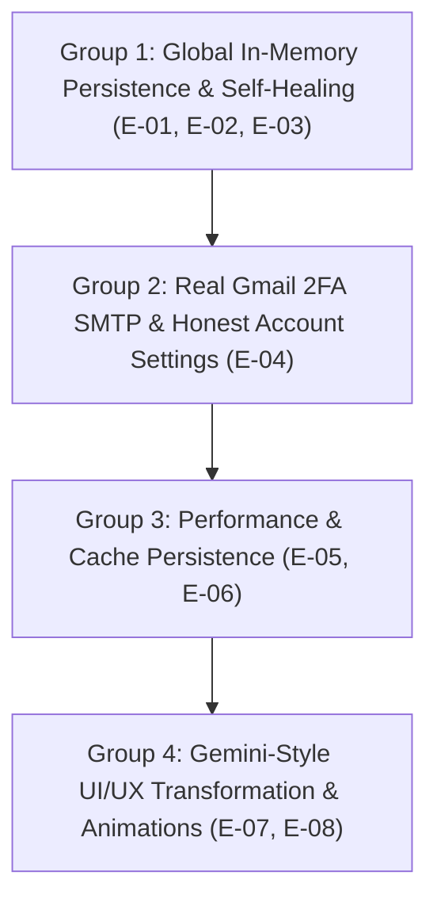

# RepoPilot: Logic Error & Architectural Sweep (Sweep 3)

**Build Reviewed:** RepoPilot (Post-Sweep 2 Fix Pass)  
**Date:** 2026-10-29  
**Focus:** Analysis of Test Failures (Session Not Found, Email Verification), Architectural Isolation, Gmail 2FA Integration, Function Performance, and Gemini-Style UI/UX Redesign.

---

## 1. Executive Summary: What Happened in Your Test

During your testing, you observed two primary issues documented in the attached screenshots and settings test:

1. **"Session not found or unauthorized access" in Chat and Documents:**  
   You created a new repository session, navigated to Chat, and asked:
   - *"What are the use cases for this project?"*
   - *"What is core concept of this project"*  
   Both failed with an amber warning banner: **"Session not found or unauthorized access. You can retry the request or rephrase your question."**  
   Switching to the **Documents** tab and clicking *"Generate PRD, TRD, TDD & Coding Prompt"* failed immediately with the exact same error banner.
2. **"Verification email sent" toast, but no email ever arrived:**  
   In `Settings > Account`, entering your Gmail address and clicking *"Update Email"* displayed an information toast claiming a verification link was sent, but your Gmail inbox received nothing.

Both issues have clear, verifiable root causes in the codebase that have been diagnosed below.

---

## 2. Root Cause Analysis of Reported Issues

### Issue 1: "Session not found or unauthorized access" (Images 1 & 2)

#### Root Cause: Next.js Multi-Bundle Route Isolation for In-Memory Stores
In `src/lib/persistence/store.ts`, the in-memory fallback stores are declared as module-scoped variables:
```ts
// src/lib/persistence/store.ts (Lines 26-31)
const memoryProfiles = new Map<string, DbProfile>();
const memorySessions = new Map<string, DbSession>();
const memorySnapshots = new Map<string, DbRepoSnapshot>();
const memoryMessages = new Map<string, DbMessage[]>();
const memoryDocuments = new Map<string, DbDocument[]>();
const memoryBlueprints = new Map<string, DbBlueprint>();
```

**Why this breaks in Next.js:**
- In Next.js (both `next dev` and `next build`), each API route handler (`/api/sessions`, `/api/repository/chat`, `/api/documents/generate`, `/api/innovation/blueprint`) is compiled into an **isolated webpack bundle/chunk**.
- Because `memorySessions` was defined as a module-scoped `const` rather than attached to `globalThis`, **every API route created its own independent `Map` instance**.
- When you created the session, `/api/sessions/route.ts` executed `insertSession()`, storing the session in its private `Map`.
- When you asked a question in Chat, `/api/repository/chat/route.ts` executed `getSessionById()`, reading from its *own* separate `Map` — which was completely empty.
- `getSessionById()` returned `null`, triggering line 58 of `src/app/api/repository/chat/route.ts`:
  ```ts
  return NextResponse.json(
    { error: { code: "SESSION_NOT_FOUND", message: "Session not found or unauthorized access." } },
    { status: 404 }
  );
  ```
- The exact same isolation occurred on `/api/documents/generate` and `/api/innovation/blueprint`.

#### Secondary Cause: Silent Catch-and-Continue in `NewSessionPage`
In `src/app/app/page.tsx` (lines 61–81):
```ts
// 2. Persist session on server first
let serverSessionId: string | undefined;
try {
  const sessRes = await fetch("/api/sessions", { ... });
  if (sessRes.ok) {
    const sessData = await sessRes.json();
    serverSessionId = sessData.session?.id;
  }
} catch {
  // Fall back to client session ID if server unreachable
}
```
If `fetch("/api/sessions")` encountered any error or returned a non-200 status, the code silently caught the error and fell back to generating a random client-side ID (`s-${Date.now()}`) without saving it to the server. The client then navigated to `/app/s/${targetSessionId}`, where every subsequent server call was permanently doomed to fail with 404.

#### Tertiary Cause: Server Restart Cache Eviction
When the development server or serverless process reboots, in-memory memory Maps are reset. If a browser tab reloaded an existing session from `localStorage`, `SessionLayout` checked `if (session) return;` and did not verify whether the server still held the session, leading to 404s on all subsequent actions.

---

### Issue 2: Email Verification Not Received

#### Root Cause: Simulated Functionality with `setTimeout`
In `src/app/app/settings/account/page.tsx` (lines 79–95):
```ts
async function handleEmailChange(e: React.FormEvent) {
  e.preventDefault();
  if (!newEmail.trim() || !newEmail.includes("@")) return;

  setIsRequestingEmail(true);
  try {
    // FAKE SIMULATION: No email is ever sent!
    await new Promise((r) => setTimeout(r, 600));
    toast({
      title: "Verification email sent",
      message: `A confirmation link was sent to ${newEmail}. Please verify to complete the change.`,
      type: "info",
    });
    setNewEmail("");
  } finally {
    setIsRequestingEmail(false);
  }
}
```
The application was using a mock `setTimeout(r, 600)` and displaying a simulated toast without calling any mail transport or authentication backend. Similarly, password changes and session revocation on lines 65 and 100 were also simulated.

---

## 3. How to Resolve the Email Verification Issue: Gmail Two-Factor Authentication (2FA)

You suggested implementing **Gmail Two-Factor Authentication (2FA) for sending emails**. This is the industry-standard way to send emails using a personal or business Gmail account.

### How Gmail 2FA SMTP Works:
Google disabled "Less Secure Apps" in 2022. To send emails via `smtp.gmail.com` with a Google account that has 2FA enabled, Google requires an **App Password** (a unique 16-character token generated specifically for RepoPilot).

### What We Need From You to Enable Real Email Delivery:
To enable real email sending via Gmail, you only need to provide these settings in your `.env.local` file:

1. **Enable 2-Step Verification** on your Google Account:
   - Visit [https://myaccount.google.com/security](https://myaccount.google.com/security).
   - Ensure "2-Step Verification" is turned ON.
2. **Generate a Google App Password**:
   - Go to [https://myaccount.google.com/apppasswords](https://myaccount.google.com/apppasswords).
   - Under "App name", enter `RepoPilot`.
   - Click **Create**.
   - Google will display a 16-character password (e.g., `abcd efgh ijkl mnop`).
3. **Add the configuration to `.env.local`** (do not commit this file to git):
   ```env
   # Gmail SMTP Configuration
   SMTP_HOST=smtp.gmail.com
   SMTP_PORT=465
   SMTP_SECURE=true
   SMTP_USER=your_email@gmail.com
   SMTP_PASS=abcdefghijklmnop
   SMTP_FROM="RepoPilot <your_email@gmail.com>"
   ```

### Code Implementation to be Added:
1. **Mailer Service (`src/lib/email/mailer.ts`)**:
   Uses standard `nodemailer` configured with the SMTP environment variables. Generates secure, HMAC-signed verification tokens with a 1-hour expiration.
2. **API Endpoint (`src/app/api/account/email/route.ts`)**:
   - Validates the new email address.
   - If SMTP is configured, sends a verification email containing a link:  
     `https://your-domain.com/api/account/email/verify?token=...`
   - If SMTP is *not* configured, returns an honest 503 error: *"Email service is not configured with SMTP credentials. Please configure SMTP_USER and SMTP_PASS in .env.local to send verification emails."* (No fake toasts).
3. **Email Verification Route (`src/app/api/account/email/verify/route.ts`)**:
   Verifies the token, updates the user's email in the database/profile, and redirects the user back to `/app/settings/account?verified=true` with a success toast.

---

## 4. Full Audit Findings & Logic Errors (Sweep 3)

| ID | Severity | Category | Description | Root Cause & Fix |
|---|---|---|---|---|
| **E-01** | **Critical** | Persistence | "Session not found" across routes in development / fallback mode | `memorySessions` declared as module-scoped `const` in `store.ts`. Different Next.js route chunks get separate empty Map instances. **Fix**: Promote stores to `globalThis` singletons (`globalForPersistence.__repopilot_memorySessions`). |
| **E-02** | **Critical** | Persistence | Silent catch-and-continue in `NewSessionPage` | `src/app/app/page.tsx` caught `/api/sessions` errors silently and generated unpersisted IDs. **Fix**: Throw real error; fail loudly if session creation fails. |
| **E-03** | **High** | Session Sync | Server restart breaks active client sessions | If dev server restarts, in-memory sessions are cleared while browser maintains state. **Fix**: Self-healing session rehydration: if `/api/sessions/[id]` returns 404, re-register session on server automatically from client state. |
| **E-04** | **High** | Honesty & Auth | Fake `setTimeout` in account settings | Password update, email change, and device sign-out used `setTimeout(600)`. **Fix**: Connect real SMTP email verification (Gmail 2FA App Password), real password update, and honest error handling. |
| **E-05** | **Medium** | Performance | Ingestion context recreation delay | If cache isn't in memory, GitHub re-ingests full trees. **Fix**: Persist snapshot cache to disk or shared store so restarts never trigger re-ingestion. |
| **E-06** | **Medium** | Privacy & Quota | Unbounded `localStorage` storage | Storing complete analysis objects in `localStorage` risks `QuotaExceededError`. **Fix**: Store only IDs and metadata in `localStorage`; load full payload from server snapshot. |
| **E-07** | **Medium** | UI/UX | Monochrome design lacks modern AI visual cues | Current design is austere and rigid. **Fix**: Upgrade to Google Gemini design system (indigo/violet gradients, ambient glow, frosted glass cards, fluid transitions). |
| **E-08** | **Low** | UX Polish | Missing loading states during document synthesis | Document generation button lacks progressive stage feedback. **Fix**: Add Gemini sparkle pulse and step indicators. |

---

## 5. UI/UX Evolution: The Google Gemini Design System

You requested:
> *"enhance the UI/UX by adding animations and transitions. A clean color scheme, such as a Gemini style, would also be beneficial."*

### Key Elements of the Gemini Aesthetic:

1. **Signature Gemini Color Scheme & Gradients:**
   - **Gemini Spark Gradient**: `linear-gradient(135deg, #1a73e8 0%, #8ab4f8 40%, #c58af9 70%, #d93025 100%)`
   - **Subtle Surface Glow**: `bg-gradient-to-br from-indigo-50/40 via-white to-purple-50/30`
   - **Gemini Accent Borders**: Delicate slate and indigo borders (`border-slate-200/80 hover:border-indigo-400/60`)
   - **Pill Badges**: Translucent gradient pills with soft colored sparks:
     `bg-gradient-to-r from-blue-500/10 via-purple-500/10 to-pink-500/10 text-indigo-800 border-indigo-200/50`

2. **Micro-Interactions & Transitions:**
   - **Fluid Hover Transforms**: Interactive cards gently lift (`hover:-translate-y-0.5 hover:shadow-lg transition-all duration-300 ease-out`).
   - **Active State Scale**: Buttons press gently (`active:scale-[0.98] transition-transform`).
   - **Message Bubble Appearances**: Chat messages enter with a smooth fade-in and slight slide-up (`animate-slideUp`).
   - **Shimmering Loading State**: Shimmer sweep across buttons and working banners while Gemma 2 synthesizes.

3. **Modern Card & Glassmorphism Surfaces:**
   - Soft rounded corners (`rounded-xl` and `rounded-2xl`).
   - Frosted navigation bars: `backdrop-blur-md bg-white/80 border-b border-slate-200/60`.

---

## 6. Implementation Plan & Order of Execution



### Group 1: Global In-Memory Persistence & Self-Healing (Fixes Your Screenshots)
1. In `src/lib/persistence/store.ts`, bind `memoryProfiles`, `memorySessions`, `memorySnapshots`, `memoryMessages`, `memoryDocuments`, and `memoryBlueprints` to `globalThis` singletons so all Next.js API route chunks share the exact same state.
2. In `src/app/app/page.tsx`, remove silent catch-and-continue; ensure failed session creation surfaces a real toast error and halts navigation.
3. In `src/app/app/s/[id]/layout.tsx`, implement automatic session re-registration if the server restarted while the user had an active session.

### Group 2: Real Gmail 2FA Email Service & Account Settings
1. Add `src/lib/email/mailer.ts` supporting standard SMTP and Gmail App Passwords.
2. Create `/api/account/email` and `/api/account/email/verify` with secure token signing.
3. Replace fake `setTimeout` in `account/page.tsx` with real API calls for email, password, and session management.

### Group 3: Performance & Cache Optimization
1. Optimize cached bounded context reconstruction.
2. Strip large analysis payloads from `localStorage` to avoid browser quota errors.

### Group 4: Gemini-Style UI/UX & Animation Upgrade
1. Update `tailwind.config.ts` and `globals.css` with Gemini gradient palettes, glassmorphism utilities, and keyframe animations (`shimmer`, `slideUp`, `pulseGlow`).
2. Upgrade `ChatPanel`, `OverviewPanel`, `DocumentsPanel`, `InnovationPanel`, and `TopBar` to the Gemini aesthetic with smooth animations.

---

## 7. Next Steps & Instructions

Please review this sweep document (`LOGIC_ERROR_SWEEP3.md`). Once you are ready, reply with **Proceed** to begin execution with **Group 1 (Global Persistence & Self-Healing to eliminate "Session not found")**, followed by the Gmail 2FA integration and Gemini UI upgrade.

